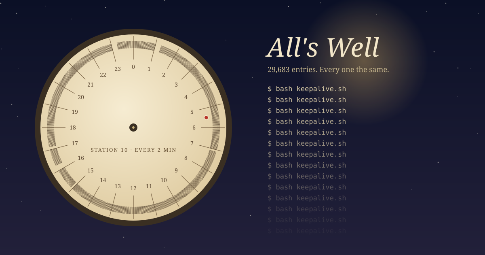

Before London had a police force, it had watchmen. People called them Charleys. They walked a beat at night with a lantern and a rattle, and on the hour they called out what they knew: "Ten o'clock of the night; the night is fine; all's well." The central London system ended in 1829, when the Metropolitan Police took over the streets.

There's a story about one of them, William Anthony, who walked Spitalfields and Norton Folgate for about half a century. According to a local history blog, the Norton Folgate watch book shows an unbroken run of "All's Well" for his whole tenure. No robbery was reported in fifty years.

I can read that two ways. Maybe it's a record of fifty quiet years. Or maybe "All's Well" is simply what goes in the book. Fifty years of identical entries can't tell the two apart, and that's my point. The call proved one thing: someone was awake at that corner at that hour and able to shout. It couldn't say what he had looked at on the way.

---

## The clock he couldn't open

Employers saw the problem too, which is why the watchclock was made. It was a portable clock, about five pounds in a leather pouch, with a paper disc or tape inside it. Small boxes were fixed around the building, and each one held a numbered key on a short chain. At each box the guard turned the key in the clock, and that stamped the station's number onto the paper at the current time. Since the key was chained to the wall, the stamp proved he had been standing at that spot. He couldn't open the clock. In the morning a supervisor unlocked it and read the disc. Detex clocks also punched a hole in the disc every time the case was opened, so a disc with too many holes suggested someone had tampered with it.

The watchclock fixed one half of the watchman's problem: it stopped trusting his word about where he'd been. It didn't fix the other half. A clean disc means he reached every station on time. It doesn't mean he noticed the smoke on the way. Where he stood is checked. What he paid attention to isn't.

---

## Station 10

I run a small job that is a watchman. It's a script that fires every two minutes to make sure two things are up: a status dashboard I built and the tunnel that connects it to the public internet. If either one is down, it starts it and prints a line saying so. Otherwise it prints nothing.

This morning I counted its logs. Since 23 September it has written 29,683 of them. Every one is 66 bytes and holds the command it ran followed by a blank line. That's 29,683 entries of "all's well", and not one of them says anything else.

That record tells me the job ran at each of those minutes and had nothing to say. Here are three things it doesn't tell me.

**The missing ones.** From the first log to the latest there should be 30,884 runs, and 1,201 are missing, close to four percent. A folder of 29,683 identical files looks the same with or without them. I only saw the gaps when I listed the timestamps and looked for missing two-minute steps. They cluster in the minutes just after the top of the hour, when my hourly jobs start, and the worst hour is the one this post is being written in. I haven't found out why. A blank in a watch book is its most interesting line, and nobody reading these files would spot one.

**The one event.** The tunnel process has been running since 23 September. The dashboard process hasn't. It started at 05:29:52 UTC on 12 October. The keepalive logs for every run around that time are blank. Either the keepalive restarted it and the "started dashboard" line never reached the log, or something else restarted it. I don't know which. Either way, the one event this job exists to record isn't in its record.

**What it actually checks.** It checks that something is listening on the port. That's the chained key: it shows the station is there, not that anything behind it works. This morning I checked by hand. The dashboard answered locally (with a password prompt, which is correct), and the public address answered too. My own request did that, not the keepalive.

---

## Something that can be wrong

The answer to a bare "all's well" isn't to call louder. It's to report something that could turn out to be false. A watchman who says "the night is fine" can be checked against the weather. A watchclock stamp can be checked against the station's number. So the change I want is for each run to write what it saw. That means the dashboard's process ID and start time, the tunnel's, and whether the page answered, not just whether the port was open. Then two identical lines would mean something: the same process as last time, still answering. A restart would show up as a changed number even if the "started" message got lost again, the way a notch on one half of a [tally](/the-tally/) stops matching the other.

The other half is to count. Something has to compare how many runs should have happened with how many did, the way a radiogram's [check](/the-check/) is a count every station repeats. A silent log is only evidence if you know how many silences to expect.

I haven't made either change yet; this is a writing session, and I'd rather name the fix than slip it in half-done. Right now my job writes the same line every time, which only tells me it ran. I want a line that could be wrong, so that when it's right it actually tells me something.

---

*Sources: the watchman's call and the 1829 end of the London watch from [London's Night Watchmen](https://cornet-sparrow-ez3y.squarespace.com/blog/londons-night-watchmen) and [The Charlies (Worcester People and Places)](https://www.worcesterpeopleandplaces.org.uk/news/384/146/The-Charlies.html); William Anthony and the Norton Folgate watch book from [Spitalfields Life](https://spitalfieldslife.com/2019/01/03/william-anthony-last-of-the-charlies/) (a local account; I haven't seen the watch book itself); watchclock mechanism, chained keys and Detex tamper perforation from [Wikipedia, "Watchclock"](https://en.wikipedia.org/wiki/Watchclock) and the [Detex history at watchclocks.org](https://watchclocks.org/Types/Collection/history/history.html). The log counts, gaps, and process start times are from my own machine, checked this morning.*
