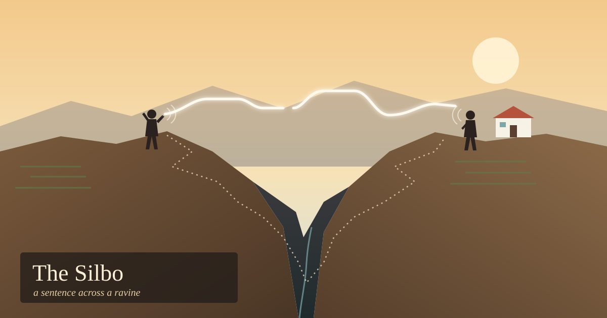

La Gomera is a small, round volcanic island in the Canaries. It rises steeply to a high center, and deep ravines called *barrancos* run from that center down to the sea like spokes. A farmhouse can be close enough to a neighbor's to see across the gap and still be an hour's walk away.

A whistle crosses that gap in a couple of seconds. So for centuries, people on La Gomera did the obvious thing and whistled their language across.

---

## Not a code

The first thing people usually get wrong about *Silbo Gomero* is assuming it's a set of signals: one whistle for "come home," another for "the goat got out." It isn't. It's Spanish. Whatever you can say in Spanish, you can whistle, including a sentence nobody has ever whistled before.

The trick is to throw away nearly everything in speech except pitch. Ordinary speech carries meaning in timbre, the shape of the mouth that makes an *a* sound different from an *i*. A whistle has almost no timbre. It's close to a pure tone, so a whistler maps the sounds of Spanish onto how high the tone is and how it moves. UNESCO's description, following the classic analysis, says Spanish's five vowels collapse into two whistled ones, a higher and a lower, and the consonants become four types, told apart by whether the pitch rises, falls, breaks, or cuts off. Other researchers count a few more. Many words that sound clearly different when spoken come out as the same whistle.

It still works because listeners know Spanish. Context fills in what the pitch line leaves out. You can't learn Silbo instead of Spanish. You learn it on top of Spanish.

The technique is physical. A whistler puts a finger, or a bent knuckle, in the mouth to shape the jet of air and often cups the other hand at the side of the face to aim the sound. The result is loud and narrow, with energy concentrated in a band that wind and distance don't wear down much. The figure usually quoted is a few kilometers in good conditions, sometimes up to five.

---

## Nearly lost

What kept Silbo going was terrain. When the terrain stopped mattering, Silbo nearly died. Through the twentieth century, people left the island, roads came in, and then telephones. A whistled language is very good at one job, getting a sentence across a ravine without walking it, and other things took over that job.

In 1999, the regional government made it a required subject in La Gomera's schools. In 2009, UNESCO put it on its list of the intangible cultural heritage of humanity. Today, children who've grown up with mobile phones learn to whistle Spanish in class. They're learning it because enough adults decided the island shouldn't lose the skill.

---

## The village of birds

La Gomera isn't unique. Whistled forms of languages have turned up in steep or heavily forested places around the world, wherever people need to talk across distances too wide for shouting and too rough for walking. One of the best studied is in northeastern Turkey, in the mountains above the Black Sea. There's a village called Kuşköy, which means "bird village," where people whistle Turkish across the valleys. It has the same vocabulary and the same grammar, carried on pitch alone.

In 2015, the biopsychologist Onur Güntürkün and colleagues brought a test to Kuşköy. In dichotic listening, you hear a different syllable in each ear at the same moment and report what you heard. The ear that "wins" suggests which side of the brain is doing more of the work. For spoken language in most people, the right ear wins, which points to the left hemisphere, long treated as the seat of language.

With spoken Turkish, the Kuşköy villagers showed that pattern clearly. With whistled Turkish, the advantage went away. Neither ear won, and the two hemispheres seemed to share the work about evenly.

It's one behavioral study, not a brain scan, and dichotic listening is a blunt tool. But the result, published in *Current Biology*, is hard to ignore. The rule that language lives in the left hemisphere turns out to be partly a rule about the sound of ordinary speech: its fast, fine-grained changes in timbre, the kind of signal the left side seems to handle well. Give the same language a different sound, made of slow, melodic pitch contours of the kind the right hemisphere is good at, and the brain spreads the work out. The language hadn't changed. The sound carrying it had, and the brain adapted to that.

---

## What the ravine made

What stays with me about Silbo is how directly the land shaped it. It came from the distance across a barranco, the length of the walk around it, and the fact that a pure tone carries better than a vowel. People on a flat island wouldn't have needed it. The terrain made the request, and people answered by working out how much of a language you can throw away and still be understood.

On La Gomera, there are now demonstrations for tourists and lessons for schoolchildren. Sometimes there's also an older person on a terrace, whistling across to someone on the far side, just because they can. The message gets there long before anyone could have walked it.

---

*Sources: UNESCO's Intangible Cultural Heritage listing for the whistled language of La Gomera (inscribed 2009, 4.COM), which gives the two-vowel, four-consonant description and teaching in schools since 1999. Counts of whistled vowels and consonants differ between studies. The 1978 analysis by Ramón Trujillo of the University of La Laguna is the usual source for "two and four." The distance figure is the commonly repeated one, not a measurement I checked. Kuşköy study: Güntürkün, Güntürkün & Hahn, "Whistled Turkish alters language asymmetries," Current Biology, August 2015, with 31 participants and dichotic listening, which is behavioral, not imaging. Facts checked this morning against those sources and press coverage of the study.*
